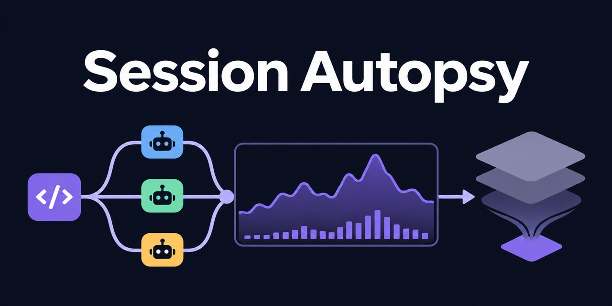
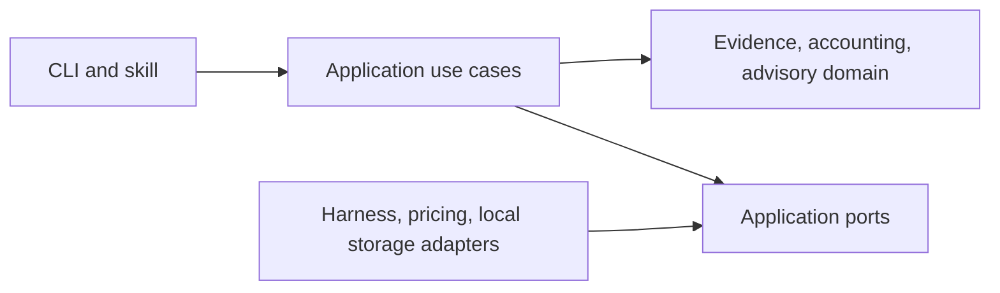

# Session Autopsy



Local session analytics for Claude Code and Codex: tokens, API cost estimates,
agent models, context compactions, and optimization advice.

[](https://sonarcloud.io/summary/new_code?id=marcelomiyake_session-autopsy)

## Install

Install the plugin in one step with Claude Code 2.1.275 or later:

```sh
claude plugin install session-autopsy --marketplace marcelomiyake/session-autopsy
```

Inside a Claude Code session, run the same command as
`/plugin install session-autopsy --marketplace marcelomiyake/session-autopsy`.
Older Claude Code versions add the marketplace first:

```sh
claude plugin marketplace add marcelomiyake/session-autopsy
claude plugin install session-autopsy@session-autopsy
```

Codex adds the marketplace and then installs from it by name:

```sh
codex plugin marketplace add marcelomiyake/session-autopsy
codex plugin add session-autopsy@session-autopsy
```

Start a new session afterward. Remove the plugin with
`claude plugin uninstall session-autopsy@session-autopsy` or
`codex plugin remove session-autopsy@session-autopsy`. For the standalone terminal
command, use `uv tool install git+https://github.com/marcelomiyake/session-autopsy`.

To work from a checkout instead, link its skill into both hosts:

```sh
python3 skills/session-autopsy/scripts/autopsy.py install --host both
```

This links `skills/session-autopsy` into `~/.claude/skills/session-autopsy` and
`~/.agents/skills/session-autopsy`, refusing conflicting destinations. Keep the
checkout available, and use either the plugin or the linked checkout, not both.
In the checkout, `uv sync --locked` followed by `uv run session-autopsy` also works.

## Architecture

One Python package separates session evidence, usage accounting, and cost advisory.
Domain rules have no filesystem, network, terminal, or vendor dependencies.
Application ports describe session sources, pricing, evidence storage, and analysis
hosts. Adapters translate native formats without exposing their schemas inward.
A harness is a tool, while a model provider supplies inference; they are separate
identities. Unsupported capabilities remain unknown.



Add a harness by implementing `SessionSourceAdapter`, registering it in the
composition root, and supplying synthetic contract fixtures. Analysis delivery
is a separate `AnalysisHostAdapter`; adding a log reader does not authorize
calling its models. Antigravity, Copilot, OpenCode, and Cursor are extension
targets, not currently supported readers.

## Development

```sh
uv sync --locked
uv run coverage run -m unittest discover
uv run coverage report
uv run coverage xml
```

Runtime dependencies use the Python standard library. Development dependencies
are isolated in the uv environment. See [AGENTS.md](AGENTS.md),
[PRIVACY.md](PRIVACY.md), and [SECURITY.md](SECURITY.md).

## Quality and contributions

New commits and PR titles follow [Conventional Commits 1.0](https://www.conventionalcommits.org/en/v1.0.0/).
Every merge requires tests, architecture checks, commit validation, and a SonarCloud analysis with zero reported issues on current main and zero PR-scoped issues. Coverage is
at least 80%; duplication is at most 3%; applicable hotspots are fully reviewed.
Free-plan PR analysis covers new code only: it cannot prove the complete candidate tree is clean before merge. All of main is scanned after each merge.

## Use

The launcher is self-contained and needs no packages:

```sh
python3 skills/session-autopsy/scripts/autopsy.py list --format json
python3 skills/session-autopsy/scripts/autopsy.py tokens latest --harness codex --offline
```

| Mode | Result |
| --- | --- |
| `list` | Recent sessions with IDs, times, initial folder and prompt |
| `pick` | Searchable terminal picker with numbered fallback |
| `tokens <session>` | Usage, current API cost estimate, models/efforts, agents, compactions |
| `postmortem <session> --host codex` | Bounded evidence for native-host explanation |
| `improve <session> --host claude` | Bounded evidence for native-host optimization advice |
| `prices refresh` | Fetch and validate current official pricing |

In Claude Code use `/session-autopsy tokens <id>`; in Codex use
`$session-autopsy improve <id>`. Plugin installs namespace the skill as
`session-autopsy:session-autopsy`, for example
`/session-autopsy:session-autopsy tokens <id>`. No selector means a chat list in the skill or an
interactive picker in the terminal. Select an ID, unique prefix, full path,
explicit `latest`, or `current` if the host exposes its session ID. Child agents
appear in their parent report and can also be selected by agent ID or path.

Filter with `--harness claude|codex`, `--since YYYY-MM-DD`, `--until YYYY-MM-DD`,
`--cwd`, `--query`, `--limit`, and `--timezone America/Sao_Paulo`. Override session
locations using `--claude-root` and `--codex-root`. Default locations are
`~/.claude/projects` and `$CODEX_HOME/sessions` (normally `~/.codex/sessions`).
Use `--format json|markdown|text` and `--output report.json` to export into
`./reports`. Output accepts a simple filename with `.json`, `.md`, or `.txt`;
directory traversal and writing outside that folder are rejected. Move an export
explicitly afterward if needed. Reports are ignored by Git and created mode 0600.

## Accounting and analysis limits

Reported usage counts come from logs, with duplicates removed. Input includes
uncached tokens plus cache reads and writes; reasoning is part of output. Prices
are refreshed after 24 hours from official Markdown tables, with a bundled
baseline and last-good cache. Use `--offline` to disable refresh or
`--prices-file path.json` for a validated custom snapshot. Dollar amounts are
estimates at current API rates, not subscription charges or historical invoices.
Unknown models/tariffs are unpriced; unknown cache lifetimes produce ranges.
Aggregate native summaries may include background calls absent from request
records. They are displayed separately and never added to overlapping usage.
Referenced Codex history outside a rollout is flagged as incomplete.

The CLI prepares analysis evidence; it does not itself invoke an AI service.
The skill dispatches a native fresh-context worker on the invoking provider:
Haiku 5.5 or GPT-6 Luna at medium effort. Explicit `--deep` uses Sonnet 5.5 or
GPT-6.1 Sol at high effort; `--effort high` raises effort on the selected model.
No automatic escalation or cross-provider fallback is provided. The coordinator
still consumes tokens under the host's current model. If explicit native model
selection is unavailable, the skill returns the packet path and stops narrative
analysis. See [the analysis reference](skills/session-autopsy/references/analysis.md) for delegation
examples and evidence requirements.

Session evidence stays local except for the bounded packet deliberately passed
to your invoking assistant provider. Pricing/documentation GETs contain no
session data. GitHub and SonarCloud receive project source and synthetic tests,
never session logs. Full details are in [PRIVACY.md](PRIVACY.md).

The Social Preview asset is 1280×640 PNG, below 1 MB, generated using the built-in
image tool from this generic prompt: “A clean technical banner titled Session
Autopsy, with abstract agent branches, a token usage trace, and context compression;
no real session content, product logos, or personal information.”

The plugin icon is a hand-authored SVG, `assets/icon.svg`, in the same palette.
`assets/icon.png` is its 1024×1024 rendering from headless Chrome.
