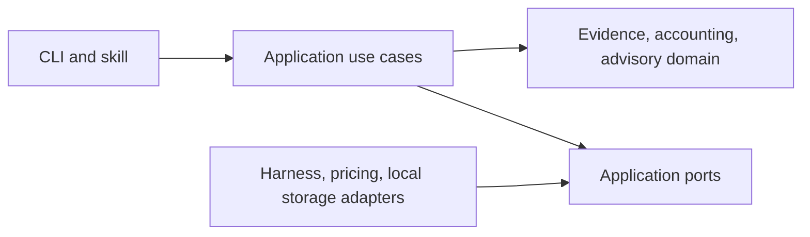

# Session Autopsy

Local session analytics for Claude Code and Codex: tokens, API cost estimates,
agent models, context compactions, and optimization advice.

[](https://sonarcloud.io/summary/new_code?id=marcelomiyake_session-autopsy)

## Architecture

One Python package separates session evidence, usage accounting, and cost advisory.
Domain rules have no filesystem, network, terminal, or vendor dependencies.
Application ports describe session sources, pricing, evidence storage, and analysis
hosts. Adapters translate native formats without exposing their schemas inward.
A harness is a tool, while a model provider supplies inference; they are separate
identities. Unsupported capabilities remain unknown.



Add a harness by implementing `SessionSourceAdapter`, registering it in the
composition root, and supplying synthetic contract fixtures. Analysis delivery
is a separate `AnalysisHostAdapter`; adding a log reader does not authorize
calling its models. Antigravity, Copilot, OpenCode, and Cursor are extension
targets, not currently supported readers.

## Development

```sh
uv sync --locked
uv run coverage run -m unittest discover
uv run coverage report
uv run coverage xml
```

Runtime dependencies use the Python standard library. Development dependencies
are isolated in the uv environment. See [AGENTS.md](AGENTS.md),
[PRIVACY.md](PRIVACY.md), and [SECURITY.md](SECURITY.md).

## Quality and contributions

New commits and PR titles follow [Conventional Commits 1.0](https://www.conventionalcommits.org/en/v1.0.0/).
Every merge requires tests, architecture checks, commit validation, and a SonarCloud analysis with zero reported issues on current main and zero PR-scoped issues. Coverage is
at least 80%; duplication is at most 3%; applicable hotspots are fully reviewed.
Free-plan PR analysis covers new code only: it cannot prove the complete candidate tree is clean before merge. All of main is scanned after each merge.
