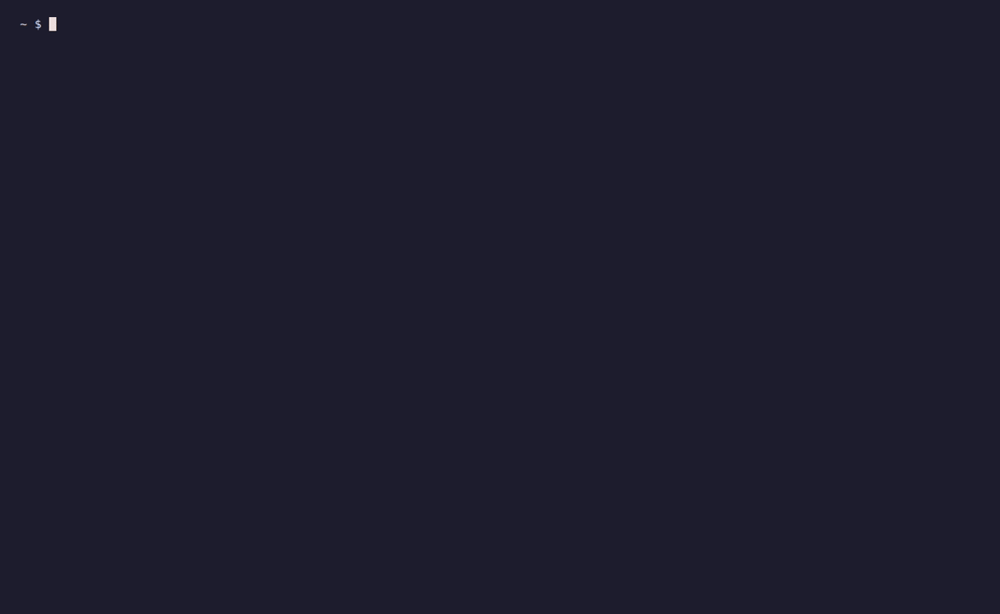
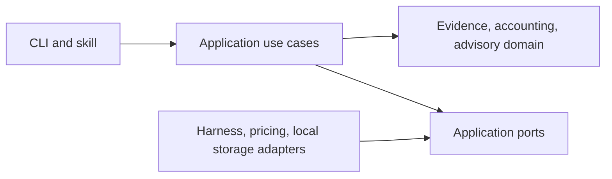

# Session Autopsy



Local session analytics for Claude Code and Codex: tokens, API cost estimates,
agent models, context compactions, and optimization advice.

[](https://sonarcloud.io/summary/new_code?id=marcelomiyake_session-autopsy)

## Install

Install the plugin in one step with Claude Code 2.1.275 or later:

```sh
claude plugin install session-autopsy --marketplace marcelomiyake/session-autopsy
```

Inside a Claude Code session, run the same command as
`/plugin install session-autopsy --marketplace marcelomiyake/session-autopsy`.
Older Claude Code versions add the marketplace first:

```sh
claude plugin marketplace add marcelomiyake/session-autopsy
claude plugin install session-autopsy@session-autopsy
```

Codex adds the marketplace and then installs from it by name:

```sh
codex plugin marketplace add marcelomiyake/session-autopsy
codex plugin add session-autopsy@session-autopsy
```

Start a new session afterward. Remove the plugin with
`claude plugin uninstall session-autopsy@session-autopsy` or
`codex plugin remove session-autopsy@session-autopsy`. For the standalone terminal
command, use `uv tool install git+https://github.com/marcelomiyake/session-autopsy`.

To work from a checkout instead, link its skill into both hosts:

```sh
python3 plugins/session-autopsy/skills/session-autopsy/scripts/autopsy.py install --host both
```

This links `plugins/session-autopsy/skills/session-autopsy` into
`~/.claude/skills/session-autopsy` and `~/.agents/skills/session-autopsy`,
refusing conflicting destinations. Keep the
checkout available, and use either the plugin or the linked checkout, not both.
In the checkout, `uv sync --locked` followed by `uv run session-autopsy` also works.

## Architecture

One Python package separates session evidence, usage accounting, and cost advisory.
Domain rules have no filesystem, network, terminal, or vendor dependencies.
Application ports describe session sources, pricing, evidence storage, and analysis
hosts. Adapters translate native formats without exposing their schemas inward.
A harness is a tool, while a model provider supplies inference; they are separate
identities. Unsupported capabilities remain unknown.



Add a harness by implementing `SessionSourceAdapter`, registering it in the
composition root, and supplying synthetic contract fixtures. Analysis delivery
is a separate `AnalysisHostAdapter`; adding a log reader does not authorize
calling its models. Antigravity, Copilot, OpenCode, and Cursor are extension
targets, not currently supported readers.

## Development

Everything a plugin install receives lives in `plugins/session-autopsy`: the
manifests, skill, `session_autopsy` package, icons, README, and license. Tests,
CI, and project tooling stay at the repository root, outside the plugin.


```sh
uv sync --locked
uv run coverage run -m unittest discover
uv run coverage report
uv run coverage xml
```

Runtime dependencies use the Python standard library. Development dependencies
are isolated in the uv environment. See [AGENTS.md](AGENTS.md),
[PRIVACY.md](PRIVACY.md), and [SECURITY.md](SECURITY.md).

## Quality and contributions

New commits and PR titles follow [Conventional Commits 1.0](https://www.conventionalcommits.org/en/v1.0.0/).
Every merge requires tests, architecture checks, commit validation, and a SonarCloud analysis with zero reported issues on current main and zero PR-scoped issues. Coverage is
at least 80%; duplication is at most 3%; applicable hotspots are fully reviewed.
Free-plan PR analysis covers new code only: it cannot prove the complete candidate tree is clean before merge. All of main is scanned after each merge.

## Use

Modes, selectors, filters, accounting rules, analysis limits, and the data the
plugin sends are documented in the [plugin README](plugins/session-autopsy/README.md),
which is also the directory listing's description.

## Privacy and branding

Session evidence stays local except for the bounded packet deliberately passed
to your invoking assistant provider. Pricing/documentation GETs contain no
session data. GitHub and SonarCloud receive project source and synthetic tests,
never session logs. Full details are in [PRIVACY.md](PRIVACY.md).

The demo GIF was recorded with VHS against synthetic sessions in a sandboxed
home directory; it contains no real session data. The Social Preview asset is 1280×640 PNG, below 1 MB, generated using the built-in
image tool from this generic prompt: “A clean technical banner titled Session
Autopsy, with abstract agent branches, a token usage trace, and context compression;
no real session content, product logos, or personal information.”

The plugin icon is a hand-authored SVG in the same palette; the PNG icon is its
1024×1024 rendering from headless Chrome.
